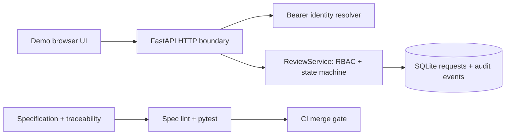

# ReviewFlow architecture

## Purpose and boundary

This application demonstrates a single spec-driven vertical slice: create a
request, review it under explicit authority, record the decision and verify
expected behavior. It is a training reference, not production access management.

## Components

- API: request parsing, status codes, identity dependency, route boundaries.
- Authentication: configured resolver; example tokens only in explicit demo mode.
- Domain service: role authorization, creator separation, visibility and state transitions.
- Persistence: parameterized SQL, transactions, DB foreign keys and constraints.
- UI: small local-only browser client; no client-side authorization decisions are trusted.
- Quality gate: `scripts/spec_lint.py` checks requirements, tasks and tests;
  pytest checks runtime behavior; mutation demo ensures the guard matters.

## API contract

| Method | Path | Authorization | Behavior |
|---|---|---|---|
| GET | `/health` | None | Storage readiness |
| POST | `/api/requests` | Requester | Create pending item |
| GET | `/api/requests` | Requester / approver | Scoped list, optional status |
| GET | `/api/requests/{id}` | Owner / approver | Detail or hidden 404 |
| POST | `/api/requests/{id}/decision` | Approver, not creator | Approve or reject |
| GET | `/api/requests/{id}/audit` | Owner / approver | Read accepted actions |
| GET | `/` | Demo mode only | Training user interface |

## Data ownership and transactions

The database is authoritative for request status and audit data. `decide()` uses
`BEGIN IMMEDIATE` to serialize SQLite writers, checks the current state inside
that transaction, writes one transition and one audit event and commits both.
On authorization or validation failure no successful action event is recorded.

A development-only bearer-token resolver is available via explicit demo mode.
An application without a configured identity resolver refuses to initialize.

## Threats and mitigations illustrated

| Threat | Reference control | Not yet covered |
|---|---|---|
| Creator approves own item | Identity-based creator check in service | Federation and delegated approval |
| Unauthorized API access | Auth resolver and roles in service | Token expiry, issuer/audience verification |
| Double approval race | Serialized writer transaction | Multi-instance distributed storage |
| SQL injection | Parameterized SQL | Broader injection assessment |
| Audit mismatch | Shared transaction | Immutable external audit storage |
| Cross-user disclosure | Scoped GET/list/audit | Fine-grained enterprise ABAC |

## Production gaps

Before use beyond local training, add a real identity provider and session
strategy, production database and migrations, rate limiting, request size
limits at ingress, secrets management, TLS, backups, telemetry, data retention,
operational incident procedures, access-control reviews, and formal threat
modeling. Demo tokens must never be deployed or exposed outside loopback.

## Architecture decisions

- `docs/decisions/0001-transactional-sqlite.md`: file-backed SQLite for simple,
  observable atomicity without container infrastructure.
