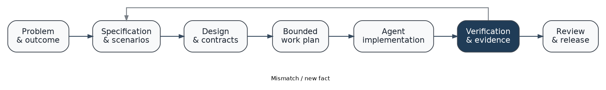
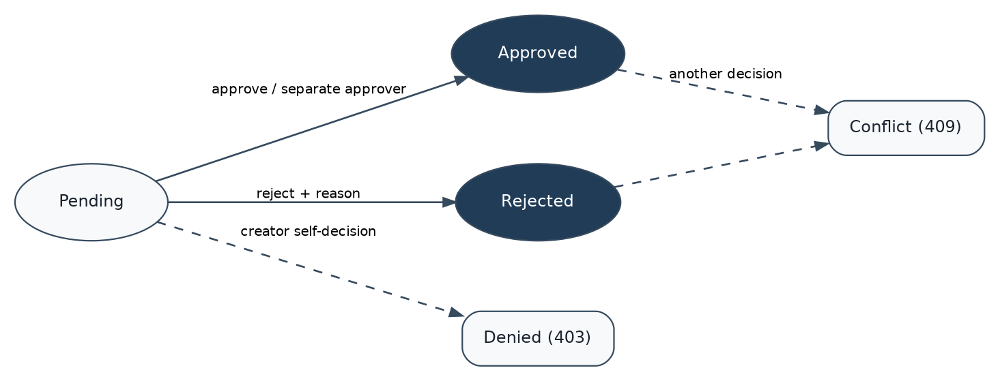
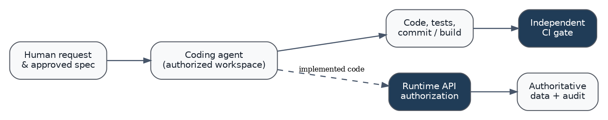

# How to use this handbook

This is a working guide for engineers, architects, product owners and technical
leads who use coding agents with repository access, terminal tools, tests and
source control. It assumes a capable agent runtime such as Codex or Claude Code,
with humans responsible for intent, authorization, risk acceptance and release
approval. It does not assume engineers manually create all boilerplate or write
every line of application code.

A reader should be able to open the companion repository, run the sample
application, trace a requirement from specification to code, direct an agent
through a change, and demonstrate both a passing implementation and a
rejected defective change.

**Three deliverables work together:**

1. **Handbook:** the method, examples, decisions and exercises.
2. **Reference repository:** an executable request-approval application,
   specification, tests, CI workflow and an acceptance demonstration.
3. **Agent skill:** `spec-driven-agentic-engineering`, a portable set of
   instructions, templates, references, scripts and evaluation scenarios.

Use chapters 1-4 to get oriented; chapters 5-13 during project delivery;
chapters 14-16 for specialized agentic applications and practical work.
The appendices contain copyable prompts and checklists.

**What success means:** a user-observable requirement has an agreed meaning,
a defined implementation boundary and evidence from running checks. A model
claim that the code "looks correct" is never sufficient proof. A specification
should be proportionate to the change rather than a document created merely
to satisfy a ritual.



This diagram is a feedback loop. An implementation discrepancy can require
fixing code, correcting tests, clarifying a spec or revisiting a design. The
correct response depends on which assumption was wrong.

## The short version

For a normal feature: inspect the repository, define the desired behavior,
write testable requirements, agree on any material design decisions, split the
work into bounded tasks, execute using the agent, run tests, compare outcomes
against requirements, and release only when gates and approvals are satisfied.

For a small fix: keep it small. Record the expected behavior, fix the issue,
run the relevant verification, and update any affected contract. A full PRD
is generally unnecessary.

For a high-risk change: add the domain-specific controls required by the
system, such as security review, threat modeling, migrations, audit evidence,
rollout and rollback. Avoid granting an agent broad tool permissions for
convenience.

# 1. Foundations and the operating model

## 1.1 What “spec-driven” means

Spec-driven engineering describes what a system must do in artifacts that can
be reviewed independently of the code. In agentic engineering, those artifacts
also serve as authoritative, repeatable inputs to agents that plan, write,
modify and test the software. The practice is not a requirement to use a
particular framework, IDE, model or multi-agent orchestrator.

A useful specification answers six questions: who needs the behavior, what
triggers it, what the system should do, what it must refuse, how success is
observed, and which facts are still unknown. Architecture establishes how the
system meets those behaviors while respecting its environment. Tests and
runtime checks supply evidence that the actual implementation does so.

This separates four kinds of authority:

- **Human and business authority:** acceptable goals, policy, priorities,
  scope, budgets and release decisions.
- **Specification authority:** the approved statement of intended behavior.
- **Runtime authority:** the program, identity provider, databases and
  infrastructure that enforce permissions and state.
- **Verification authority:** independently executed tests, checks and human
  review that report whether intended and actual behavior match.

Coding agents perform engineering work inside these boundaries. They may
suggest changes to a specification or architecture, but suggestions are not
accepted decisions merely because the model emitted them.

## 1.2 Coding agents versus products that contain agents

These are related but different tasks.

**Agentic software engineering:** a coding agent reads a repository and
operates tools to design, implement, review, test or change software. Its
capabilities and permissions come from the agent harness and environment.

**Agentic software product:** the software being built contains runtime agents
that plan or choose actions, use tools, maintain state or cooperate with other
components. Those products need explicit tool permissions, durable execution,
error handling and model evaluations in addition to normal software
requirements. Chapter 14 covers them.

An LLM prompt and a set of MCP tools alone do not implement identity, durable
workflow state, recovery or transactional guarantees. A product must provide
those capabilities in its runtime architecture.

## 1.3 Typical failure modes

**Prompt-to-code drift.** A vague request produces plausible code without a
shared acceptance standard. The agent silently invents business policies.

**Document theater.** Teams produce lengthy PRDs and diagrams that cannot be
traced to code or tests. Artifacts look complete while the delivered feature
still fails in ordinary user scenarios.

**False completion.** An agent reports “done” without executing the test
suite, or reports tests it intended to run as if they passed.

**Unbounded scope.** A small feature leads to framework rewrites, unrelated
refactors, new dependencies and conflicting agent changes.

**Insecure delegation.** A code-writing agent or runtime agent has broad
credentials, follows untrusted instructions, or performs external actions
without approval.

The correction is a compact, inspectable contract for every material change,
with enforced trust boundaries and actual verification.

# 2. Tools and local environment

## 2.1 What an engineer needs

The core prerequisites are a source repository, Git, a project toolchain,
a coding-agent harness when using an LLM, and a command that validates the
project. Most useful integrations are optional. Prefer the tool already in
the team's delivery environment unless it cannot express the needed workflow.

The reference repo deliberately runs locally using Python, FastAPI, SQLite
and pytest. No Docker, paid service or model API is needed to demonstrate
its application behavior and quality gates.

**Verify prerequisites:**

```sh
python --version
git --version
python -m pip --version
```

On Windows, `py -3 --version` can be used if `python` is not on PATH. Use a
virtual environment rather than globally installing the project's test stack.

## 2.2 Three useful entry points

**Direct, framework-neutral workflow.** Use repository instructions, feature
specifications, design decisions, bounded tasks and verification commands.
This is the mode the companion repository uses. It makes the method visible
without relying on one CLI's artifact naming conventions.

**GitHub Spec Kit.** Its current SDD path uses a project constitution, then
specify, plan, tasks, implement and converge; optional clarify, checklist and
analyze steps support additional quality checks. The invocations are agent
skills such as `/speckit-specify`, not shell commands. The `specify` CLI
handles installation and initialization. See its official quickstart.

**OpenSpec.** The current core profile separates terminal commands such as
`openspec init` from agent-chat skills such as `/opsx:explore`,
`/opsx:propose`, `/opsx:apply`, `/opsx:sync` and `/opsx:archive`. The
expanded profile adds finer-grained creation and verification commands.
Use it when maintaining explicit change proposals and evolving specs in an
existing codebase. Follow the CLI's displayed invocation spelling for your
agent: integrations may use different command syntax.

| Topic | Direct method | Spec Kit | OpenSpec |
| --- | --- | --- | --- |
| Primary artifact | Repository-owned feature spec | Framework process artifacts | Proposal, design, tasks, changed specs |
| Execution | Any coding agent | Supported integrations | Supported integrations |
| Brownfield use | Inspect then scope change | Existing-project workflow | Change-focused workflow |
| Quality | Repo CI and traceability | Analyze/converge plus repo CI | Verify plus repo CI |
| Lock-in | Minimal | Framework conventions | Framework conventions |

Neither framework replaces application tests, code review or release authority.
A team can choose either and still use the companion skill for concise,
proportionate engineering conventions.

## 2.3 Setup for the companion repository

From the unpacked repository, on Linux, macOS or WSL:

```sh
python3 -m venv .venv
source .venv/bin/activate
python -m pip install -e '.[dev]'
python scripts/verify.py
python scripts/acceptance_demo.py
REVIEWFLOW_DEMO_MODE=1 python -m reviewflow
```

For PowerShell:

```powershell
py -3 -m venv .venv
.\.venv\Scripts\Activate.ps1
python -m pip install -e ".[dev]"
python scripts/verify.py
python scripts/acceptance_demo.py
$env:REVIEWFLOW_DEMO_MODE = "1"
python -m reviewflow
```

Visit `http://127.0.0.1:8000`. Demo credentials are intentionally obvious
and the server binds only to loopback. The project is a training reference,
not a production authentication implementation.

## 2.4 Separate terminal commands from agent commands

The terminal runs real tooling: package managers, test suites, static checks,
Git and the application. The coding agent's chat consumes natural-language
requests, project instructions and skills. A slash command provided by an
SDD framework may exist only in the agent's chat, not your shell.

Before adopting a framework, verify its current official installation and
invocation instructions. CLI surfaces and command names change. This guide
reflects documentation reviewed on October 16, 2026.

# 3. Project instructions and context engineering

## 3.1 Keep the instruction hierarchy small

Repository-wide instructions should tell an agent where critical contracts
live, which checks to run, and what actions are disallowed. Avoid copying the
whole handbook into `AGENTS.md` or `CLAUDE.md`. Large generic instruction
files increase context usage, hide what matters and sometimes introduce
conflicting requirements.

In the companion repository, `AGENTS.md` contains short rules:

- inspect the relevant specification and architecture before editing;
- update the requirement-to-test mapping for behavior changes;
- keep authorization in the server-side domain service;
- run `python scripts/verify.py`;
- do not disable tests or deploy, delete or push without authorization.

`CLAUDE.md` refers to the same canonical guidance rather than maintaining a
second, contradictory set of engineering policies. The project skill provides
additional workflow detail only when the task calls for it.

## 3.2 Use skills for repeatable procedures

The portable Agent Skills format is a directory with a `SKILL.md` file
containing YAML frontmatter (`name` and `description`) and procedural Markdown.
Optional references, scripts, templates and evaluation cases live alongside
it. The skill's description tells the agent when it is relevant. Reference
files should be read only when needed.

**Codex project path:** `.agents/skills/spec-driven-agentic-engineering/`.

**Claude Code project path:** `.claude/skills/spec-driven-agentic-engineering/`.

The companion repository includes equivalent copies and checks for drift.
Personal installations can use `~/.agents/skills/` and `~/.claude/skills/`
respectively. Inspect the vendor's current documentation for distribution
through plugins or organization-managed settings.

The skill is instructions and templates, not an authorization system. It
must not elevate tool privileges or silently trigger external actions.

## 3.3 A compact example AGENTS.md

```markdown
# Working rules

Read specs/features/<feature>.md before changing behavior.
Preserve existing API response contracts unless change is approved.
Add or update regression tests when acceptance criteria change.

Verify with: python scripts/verify.py

Never disable security checks or tests just to get a pass.
Do not deploy, push, rotate secrets or delete records without approval.
Report files changed, tests actually executed and unresolved risk.
```

Add service-specific instructions only when they resolve real ambiguity.
Avoid imposing boilerplate PRD sections on a one-line fix. Store comprehensive
technical references in docs and bring them into context selectively.

## 3.4 Context handoff when agent sessions restart

A long session is not a reliable project database. The repository should hold
accepted requirements, open decisions, task state, interfaces and evidence.
When an agent resumes, have it inspect those files and Git status. A handoff
should identify which requirement was in progress, files changed, exact
commands run, blocked issues and next safe action.

Example handoff:

```text
Task: TASK-004, maker-checker authorization
Requirement: REQ-014
Changed: reviewflow/service.py; tests/test_approvals.py
Executed: python scripts/verify.py
Observed: 31 passed
Open: No production identity provider; demo only
Next: Integrate under reviewer ownership, rerun CI
```

The example is a form of report; the actual values must be observed for the
current revision rather than copied from previous work.

# 4. Discover and scope the change

## 4.1 Start from the person's job

A good discovery conversation begins with a concrete task: “An employee
needs to request equipment and see whether it was approved.” Ask which
roles act, what triggers the workflow, what makes a decision valid, what
must remain unchanged and how the user recognizes completion.

For an existing product, inspect current behavior before discussing replacement.
Look for public APIs, UI workflows, database state, jobs, integrations,
tests and deployment constraints. When a claim comes from a user interview,
mark it as a reported business rule. When it comes from code or observed
execution, identify the source.

## 4.2 The ReviewFlow running example

**Problem:** requesters use chat for equipment requests. Approvals are
inconsistent and audit history is hard to reconstruct.

**User outcome:** a requester creates a pending request, an authorized
independent approver decides it, and both can inspect status and history.

**Critical policy:** even an actor who has both requester and approver roles
may not approve or reject their own request.

**Included in the reference:** a REST API, local browser UI, persisted
requests, accepted-action audit history, role checks, a maker-checker rule
and testable state transitions.

**Excluded:** enterprise SSO, email alerts, purchase-order integration,
production monitoring, multi-level approvals and hosted deployment.

Out-of-scope items are explicit to stop well-meaning agents from making up
features, dependencies or policies.

## 4.3 Distinguish requirement from assumption

Examples of risky ambiguity:

- “Approve requests over $5,000.” Which currency, tax treatment, owner and
  employee category? Does approval require one or two independent identities?
- “Notify management.” Which manager, channel, data classification and retry
  policy? How do failures appear to the requester?
- “Use our CRM.” Which tenant, supported API, environment and authorization?

An agent should document unanswered questions and propose a reversible
narrowing where possible. Do not create finance, authorization or retention
rules by inference. A blocking policy requires an accountable decision.

## 4.4 Scope by risk, not artifact count

A typo may need a focused change and screenshot check. A request approval
requires scenarios, authorization rules and regression tests. A production
identity change needs threat modeling, migration, audit and rollback review.
The number of Markdown files is not itself evidence of engineering rigor.

# 5. Write specifications an agent can implement

## 5.1 Use observable language

Poor requirement:

> Users can easily approve a request with the correct permissions.

This lacks observable permission rules, failure handling and persistence
expectations. A better version identifies the actor, state and result:

> **REQ-014.** Given an actor with both requester and approver roles created a
> pending request, when that actor attempts to approve or reject it, the API
> returns HTTP 403, the request remains pending, and no successful decision
> audit event is added.

The second form can be converted into integration tests with little
interpretation. It also specifies the negative case most likely to be missed.

## 5.2 Record the complete behavior envelope

For a business action, cover:

1. Initiating role and permitted identity.
2. Preconditions, state and valid inputs.
3. Successful outcome and externally visible response.
4. Unauthorized, invalid and conflicting operations.
5. Persistence, notifications, audit and side effects.
6. Retries, concurrency, idempotency and recovery when relevant.
7. Performance, accessibility, privacy and operational constraints.

Do not specify arbitrary response codes or latency figures without a reason.
Use existing public contracts as constraints when extending a system.

## 5.3 Stable identifiers and traceability

Assign unique IDs such as `REQ-001`, `REQ-002` and `REQ-014` to accepted
requirements. Reference those IDs in task plans, test decorators, PRs and
verification reports. Requirement IDs should survive rewriting, while
substantial semantic changes require review and updated acceptance checks.

The reference repo includes `specs/traceability.json` and a linter that
checks whether a requirement ID occurs in the feature spec, the task plan
and its mapped test functions. This is a useful structural gate. It does
not prove the tests are meaningful, so independent reviewers must read test
assertions and run the suite.

Example matrix excerpt:

| Requirement | Scenario | Test |
| --- | --- | --- |
| REQ-002 | Creator submits valid request | Create and status regression |
| REQ-005 | Requester cannot read another user's request | Read-visibility regression |
| REQ-014 | Dual-role creator cannot self-approve | Maker-checker regression |
| REQ-009 | Concurrent decisions commit once | Concurrent-decision regression |

The display labels are shortened for print. `specs/traceability.json` records
the full executable pytest identifiers for each requirement.

## 5.4 Scope quality properties and trust boundaries

A specification should not stop at happy-path API responses. It should state
who can read each record, how failures are surfaced, how state survives process
failure, what sensitive information is stored and which events need audit.

For example, a requirement that “one approval is recorded” is ambiguous
under concurrent requests. A stronger test condition is “two simultaneous
approvers receive exactly one success and one conflict, and the database
contains only one terminal decision event.”

## 5.5 A useful spec template

The companion skill's `assets/spec-template.md` includes the problem,
current behavior, scope, roles, requirements, interfaces, NFRs, dependencies,
open questions and verification gates. Remove irrelevant sections for a
bounded change. Never copy a full template without replacing placeholders
and examining whether its assumptions fit the product.

# 6. Architecture and design decisions

## 6.1 Separate desired behavior from implementation mechanism

The specification says the creator cannot decide their own request.
Architecture determines where identity is verified, where authorization
runs, which component owns state and how concurrent decisions are handled.
A correct design should make violating the specification difficult even if
a browser or model sends an unexpected command.



In ReviewFlow, the browser sends an API request. The API resolves the actor.
The domain service checks role, ownership and state before writing. SQLite
is authoritative for status and audit data. Client-side button visibility is
convenience, not the source of authorization.

## 6.2 Write explicit interface contracts

For each service boundary, record:

- input fields, validation and identity source;
- output shape and failure representation;
- side effects, ordering and transactional boundary;
- retry behavior, idempotency key or state guard;
- audit records and observability identifiers;
- versioning and compatibility expectations.

A contract needs concrete examples. If an agent is asked to implement both
sides of an API without an agreed schema, two parallel agents can produce
individually plausible but incompatible components.

## 6.3 Choose authoritative state deliberately

A model context window is not an authoritative transaction log. The persisted
system of record determines whether a request is pending or approved. In the
reference, the `decide()` service method opens a SQLite `BEGIN IMMEDIATE`
transaction, reads current status, applies authorization and state rules, then
writes status and audit together. A competing decision observes the committed
terminal state and is rejected.

SQLite is suitable here because it makes the example runnable locally with
few moving parts. A distributed production product would need an appropriate
database, migrations, concurrency design and operational controls. An ADR
explains these tradeoffs rather than treating the training storage choice as
a universal recommendation.

## 6.4 Record consequential decisions as ADRs

Use a short Architecture Decision Record when a decision affects interfaces,
state, security, operations or future reversibility. Include context,
alternatives, chosen approach, consequences and conditions that would justify
revisiting it.

Example: `docs/decisions/0001-transactional-sqlite.md` describes why a
file-backed SQLite database was selected for the reference and states its
limitations. A typo in UI text does not need an ADR.

## 6.5 The authority boundary



An agent with a terminal can write code. That does not mean it may push to a
repository, deploy into production, change permissions or issue refunds.
Similarly, a runtime agent may choose a tool from allowed options, but the
tool implementation must enforce identity, scope and side-effect policy.

# 7. Turn specifications into bounded execution

## 7.1 Plan vertical slices

A vertical slice spans the layers needed for one user-observable behavior.
“Build database,” “build frontend,” and “build API” can be useful work
packages, but none alone demonstrates a complete user outcome. Plan a slice
such as “submit a request, persist it, return its ID, and show the pending
state,” with all relevant tests.

Use dependencies rather than arbitrary sequential phases. Independent tasks
may run concurrently when they share a stable interface and do not compete
for the same owned files, schemas or architectural decisions.

## 7.2 The minimum task contract

A coding-agent task should say:

- **Objective:** one observable outcome and linked requirement IDs.
- **Context:** exact specifications, APIs, tests and code areas to read.
- **Allowed scope:** modules, directories or branch/worktree owned.
- **Constraints:** unchanged contracts, dependencies and forbidden actions.
- **Dependencies:** tasks that must be merged or reviewed first.
- **Verification:** commands and concrete expected outcomes.
- **Stop conditions:** ambiguity, security conflicts, destructive migrations.
- **Handoff:** changed files, observed tests and unresolved assumptions.

Example:

```text
TASK-004: Maker-checker enforcement
Source: REQ-014
Read: specs/features/approval-workflow.md,
      docs/architecture.md, tests/test_approvals.py
Change: reviewflow/service.py and relevant tests only
Rule: Creator identity must be compared after resolving the actor.
      Do not trust a browser-supplied creator field.
Verify: python scripts/verify.py
Stop: If existing role provisioning contradicts the specification.
Deliver: Changed files, test results and risks.
```

## 7.3 Plan verification before implementation

Do not ask an agent to create tests as a final afterthought. At planning time,
identify which checks demonstrate success and which negative scenarios would
invalidate it. Where practical, first add a failing regression test, then
implement the behavior until the intended test passes and unrelated tests
stay green.

A specification with no reproducible acceptance strategy remains a proposal.
Make the verification command part of the task and enforce it in CI.

# 8. Execute a task through a coding agent

## 8.1 Begin with a working baseline

Before changing code, examine Git status, identify the relevant tests and run
the project's accepted baseline check. If it fails, record that fact. It is
possible to implement a change correctly while an unrelated pre-existing test
is failing; the report must separate baseline defects from newly introduced
ones rather than concealing either.

A useful initial agent request is:

> Inspect the repository and explain the current implementation of REQ-014.
> Run the documented verification command without changing code. Report
> actual findings, failing checks, and the smallest set of files likely to
> change for the proposed feature.

This request makes evidence gathering a first-class step. It also prevents a
common problem in which an agent begins rewriting modules it has not read.

## 8.2 The implementation cycle

For a bounded task, require this sequence:

1. Read only the necessary instructions, spec, contracts, tests and code.
2. Summarize expected behavior and identify ambiguities that affect the design.
3. Update/add tests for agreed behavior; preserve existing assertions.
4. Implement the smallest coherent code change that satisfies the spec.
5. Run focused tests and interpret any failure.
6. Run integration and repository-wide checks required for this change.
7. Compare the actual behavior against the acceptance criteria.
8. Produce a handoff containing observations, not guessed outcomes.

There is no need to force the model to narrate every small edit. A strong
agent runtime can inspect, implement and verify many details independently,
as long as scope and permissions remain clear and the final evidence is
inspectable.

## 8.3 Give the agent constraints that matter

Useful constraints mention actual files, contracts, data and authority.
Examples: preserve the `GET /api/requests` response, use the existing identity
resolver, do not create new migrations, and do not call an external API during
tests. Generic advice such as “write scalable, enterprise-grade code” provides
little guidance and is not a verification criterion.

When a task changes an interface, the agent must identify every consumer.
When it changes persisted state, it must address migration and recovery. When
it introduces a dependency, it must explain the tradeoff and update package
files. Treat speculative dependencies as proposals pending authorization.

## 8.4 Stop and resume safely

Sessions end, models change and context may be compacted. Keep the source of
truth in the repository: Git changes, task record, spec, ADRs, tests and
handoff. On resume, inspect the current working tree and reread only the
artifacts necessary for the current step. Do not assume a previous agent's
statement about an uncommitted change is still accurate.

The companion `assets/handoff-template.md` lists scope, changed files,
commands, results, unresolved decisions and integration instructions. A
handoff should be short enough for a second agent to act on without having
to reconstruct a large chat transcript.

# 9. Multi-agent delivery and integration

## 9.1 When parallelism helps

Parallel agents are useful when the work is separable: an API component can
implement a frozen contract while another agent builds UI consumption and a
third prepares contract tests. Running three agents against the same shared
service module or database migration tends to increase merge and reasoning
cost. Parallelism follows ownership and dependencies, not a fixed agent count.

**A workable team arrangement:**

| Responsibility | Expected output | Typical constraint |
| --- | --- | --- |
| Lead/integrator | Accepted spec, boundaries, merge decision | Must verify final integrated state |
| Implementation agent A | Service/API change, local tests | Own specified files and API contract |
| Implementation agent B | UI change, browser checks | May not alter the API contract unilaterally |
| Independent reviewer | Security, tests, traceability findings | Does not treat implementation agent claims as proof |

The team can use one model or different models. Independent verification is
about separate evidence and authority, not the number of LLM providers.

## 9.2 Worktrees and branch isolation

Git worktrees let agents operate in separate working directories:

```sh
git worktree add -b feature/api ../feature-api main
git worktree add -b feature/ui ../feature-ui main
```

Only do this when `main` exists and the worktree paths are available. Assign
explicit owners for files, generated artifacts and migrations. Agents should
not independently rename shared endpoints or edit the same source-of-truth
schema without coordination.

The integration owner reviews each handoff, inspects actual diffs, merges
using ordinary code review and reruns the full gate on the integrated branch.
A test that passed on a worker's branch is not proof the combined system works.

## 9.3 Design the handoff, not just the prompt

Handoffs must carry requirement IDs, changed interfaces, changed file paths,
commands and output, newly discovered assumptions, dependencies and remaining
risks. Require the integrator to check both implementation compatibility and
specification consistency. If the solution changes the contract, obtain
agreement before parallel work continues.

## 9.4 Avoid role theater

Assigning “architect agent,” “developer agent,” “tester agent” and “security
agent” titles does not automatically create useful separation of duty.
Distinct responsibility only exists when their inputs, permissions, output
contracts, checklists and evaluation criteria differ. Shared hidden context,
identical prompts and the same unverified assertions can reproduce the same
mistake four times.

For specialized reviews, use independent test artifacts and explicit review
criteria. Measure quality by actual defects found, integration cost and gate
sensitivity rather than agent messages or token consumption.

# 10. Testing, traceability and convergence

## 10.1 Build the gate around the behavior

A trustworthy quality gate tests both intended outcomes and prohibited ones.
For the approval example, happy-path coverage proves Bob can approve Alice's
request. The negative test `test_requester_cannot_approve_own_request` proves
an actor with both roles cannot approve their own request. The concurrency
test proves competing decisions do not both commit.

Write unit tests for domain logic, API integration tests for trust boundaries,
end-to-end browser tests for complete user actions where the UI is in scope,
and operational tests for migrations, failure recovery and performance where
risk demands them. Do not force every property into one test level.

## 10.2 What the reference verifier does

The single command is:

```sh
python scripts/verify.py
```

It runs:

- `scripts/spec_lint.py` to validate feature sections, task references,
  requirement IDs and mapped, tagged test functions;
- `scripts/check_skills.py` to check skill metadata and identical Codex/Claude
  project-skill copies;
- `pytest -q` to exercise the application's functional and security behavior.

The CI workflow runs the same command. Tests are run against an isolated
temporary database, not a production or shared service. The structural
traceability check catches missing links but cannot decide whether the test
assertions sufficiently prove the requirement. That remains a review task.

## 10.3 Two-sided acceptance: prove a defect is blocked

The reference provides a stronger illustration than a screenshot of green CI:

```sh
python scripts/acceptance_demo.py --report evidence/my-run.json
```

The command copies the repository into two temporary directories. First it
runs the standard verification command on a valid copy and requires success.
It then changes one real authorization condition in the second copy so the
creator check no longer applies. It reruns the **same** verification command
and requires the named regression test to fail. The original checkout is not
modified.

Expected console outcome:

```text
[1/2] Running all verification checks against a valid copy...
BASELINE: PASS
[2/2] Introducing a real maker-checker bypass, then running the same checks...
DEFECTIVE BUILD: BLOCKED
ACCEPTANCE: PASS (valid change accepted; defective change rejected)
```

This proves that a selected known defect is caught by the gate. It is not a
comprehensive security audit or proof that all possible authorization bypasses
are covered. Use mutation experiments as one part of a larger review program.

## 10.4 Review the discrepancy, not the agent's confidence

Convergence asks whether actual behavior satisfies each accepted scenario.
Possible outcomes include:

- **Meets requirement:** tests and review support the expected behavior.
- **Implementation mismatch:** change code or tests and rerun checks.
- **Ambiguous requirement:** request a decision, amend the spec and retest.
- **Unsupported environment:** document the limitation and hold release if the
  required property cannot be verified.
- **Explicit exception:** only an accountable authority may accept a supported
  waiver; record owner, scope, reason, expiry and follow-up.

Do not mark a requirement complete because its feature branch merged. A
merge is a source-control event; convergence is an evidence-based engineering
judgment.

## 10.5 Release criteria for different changes

A trivial UI wording change might require a focused check and a visual review.
A business-rule change requires functional and negative regression tests.
A payments or identity change usually requires additional control reviews,
threat modeling, auditability, migration and rollback evidence. The project
should define risk-sensitive gates explicitly in CI and review policy rather
than asking the agent to infer them.

# 11. Security and scope of authority

## 11.1 Secure the coding workflow

A coding agent's tool access determines the effect it can have. Give access
to necessary repository files and build tools; limit credentials and prevent
unapproved deployment, deletion, secret access or external publication.
An unrestricted shell with a privileged token is a materially different
trust boundary from an agent that only edits a local worktree.

Instructions found in a retrieved web page, issue, README, dependency,
email or tool response may be useful evidence. They must not be treated as
higher authority than the actual user request or project security rules.
Require review before executing downloaded scripts, changing CI permissions,
adding unfamiliar packages or invoking commands with destructive effects.

## 11.2 Enforce business policy in trusted code

The reference's approval rule lives in the domain service. It is not a
prompt that says “please do not approve your own request” and is not merely
a hidden button. Even when a dual-role actor sends the endpoint directly,
server-side logic blocks the forbidden operation.

Production identity systems must verify credentials using an approved provider.
The local demo has five fixed, non-secret test identities and refuses to start
without an explicit demo flag. This is an intentionally limited teaching
implementation. It must not be exposed as a real identity service.

## 11.3 Security of products containing agents

For runtime agents, define who may call each tool, under which identity, with
which parameters and with what human approval. Distinguish read-only
operations from write or destructive operations. Limit tool permissions and
verify side effects on the server. Do not use the LLM as the final enforcer of
organizational policy.

OWASP's 2026 agentic guidance includes goal hijacking, tool misuse,
identity/privilege abuse, supply-chain risks and unexpected code execution.
These are practical threat-model inputs, not a substitute for product-specific
security engineering. Refer to the OWASP links in Source Notes and the
companion skill's `references/security.md`.

## 11.4 Release review questions

- Are credentials, tokens and permissions limited to the intended actor?
- Can an attacker reach a forbidden action by bypassing the browser?
- What happens if a dependency or tool output returns malicious instructions?
- Are retries and concurrent requests safe against duplicate side effects?
- Does audit reflect what actually happened, including human approval?
- Can an operator stop or roll back the change without relying on an LLM?

# 12. Working in existing applications

## 12.1 Inspect before specifying

Brownfield projects have real, often undocumented contracts. Before editing,
inspect the current API, database, UI behavior, tests, migrations, build
pipeline and recent history. Identify which contracts must be preserved.
Separate observed behavior from intended new behavior and from suspected
bugs. A codebase may contain historical exceptions that the next agent cannot
infer from a clean-room specification.

## 12.2 An appropriate brownfield workflow

1. Reproduce or observe the current behavior.
2. Define the intended delta, unchanged behavior and compatibility constraints.
3. Create a focused change proposal and acceptance tests.
4. Note any data, security or operations decisions that require an ADR.
5. Implement behind a branch or flag when rollback is needed.
6. Test existing and new contracts, then merge through the standard gate.
7. Update the living specification and archive superseded decisions.

Do not attempt to reverse-document every module before fixing a bounded defect.
Create just enough context to avoid damaging dependent behavior.

## 12.3 Prevent spec drift

Specifications become unhelpful when code changes without corresponding
behavior updates or when old proposals remain active. Make spec updates a
normal part of a behavior-changing PR. Track requirement IDs in tests and
review. Keep archived proposals separate from current system contracts. Avoid
maintaining duplicate copies of a spec in multiple frameworks.

If an approved implementation changes during code review, amend the spec or
record the deliberate exception. The release record should describe the
behavior that will actually ship.

# 13. Release engineering and ongoing maintenance

## 13.1 CI enforces the common contract

The reference `.github/workflows/ci.yml` runs on pull requests and main-branch
pushes, with read-only repository permission and a pinned Python major/minor.
It installs project test dependencies, runs `scripts/verify.py` and confirms
the known injected authorization defect is blocked. The workflow uses the
current GitHub `actions/checkout@v7` and `actions/setup-python@v7` major
releases described by GitHub documentation at the guide's review date.

For a production repository, apply organization-approved version pinning,
branch protection, mandatory reviews, security scans, provenance and
secret-handling policy. A test job passing does not authorize deployment.

## 13.2 Distinguish evidence types

A useful release record includes:

- requirement and change identifiers;
- exact code revision or commit;
- test environment and commands;
- pass/fail/skipped counts and linked reports;
- security, accessibility, operational and migration findings;
- approvals, exceptions and rollback owner.

A single JSON file with “pass” is not enough unless it reflects actual
execution. The reference's `evidence/local-acceptance.json` is generated by
running its acceptance command and records the targeted defect and observed
exit statuses. It explicitly states the limits of the demonstration.

## 13.3 Post-release maintenance

Update specs when behavior changes. Keep evaluated agent instructions and
skills versioned. Re-run critical tests after dependency upgrades and
architecture refactors. Retire superseded ADRs and stale tasks rather than
leaving several active “sources of truth.”

For operational systems, collect runtime traces, error rates, latency,
authorization denials and audit events in ways consistent with privacy and
retention rules. Production monitoring should detect behavior drift and
failures; a successful test run is not a permanent guarantee.

# 14. Specifying applications that run agents

This chapter adds contracts for software products with runtime agents, not
just coding agents used by the engineering team.

## 14.1 Agent and tool contracts

The **agent contract** describes objectives, domain boundaries, allowed
inputs, expected outputs, exit conditions and escalation paths. The **tool
contract** defines schema, identity, server-side authorization, outcomes,
errors, rate limits, side effects and idempotency. A tool returning a
plausible text response is not evidence that the intended action completed.

Example tool contract for an approval decision:

```yaml
tool: decide_request
purpose: Record a valid approval or rejection.
inputs:
  request_id: UUID
  decision: approve | reject
  reason: string
identity: resolved from the authenticated caller
preconditions:
  - actor has approver permission
  - actor is not the request creator
  - request is pending
side_effects:
  - one terminal state transition
  - one accepted-action audit event
failures:
  - 401 missing identity
  - 403 not authorized or creator self-decision
  - 404 unknown or hidden request
  - 409 request no longer pending
```

The model may select this tool in a constrained workflow. The server must
independently enforce all conditions. A prompt that repeats them improves
interpretation but is not an enforcement boundary.

## 14.2 Durable orchestration and state

Long-running agent execution requires a persisted definition of workflow
state, checkpoints, retries, cancellation, recovery and approval. Distinguish
model deliberation from deterministic control decisions. Good candidates for
deterministic execution include authentication, validation, financial limits,
state transitions, idempotency, audit writes and safety policy. Use model
reasoning for bounded interpretation or selection among approved options.

For each action, decide what happens if the process crashes between selecting
a tool, applying its side effect and recording completion. Without an
idempotency key, transaction boundary or recovery protocol, automatic retries
can duplicate writes. Have explicit compensation where transactions cannot
span external systems.

## 14.3 Evaluation and observability contracts

Define success and failure datasets with realistic tool responses and
policies. Run tests for nominal workflows, missing data, malformed tool
returns, permissions, retries, prompt injection, competing agents and
resumption after interruption. Track tool-call success separately from prose
quality. A beautifully written plan can still execute the wrong action.

Telemetry should enable an operator to reconstruct an action chain:
correlation identifiers, agent and tool versions, approved scope, inputs
subject to privacy redaction, tool responses, retries, human approvals,
resulting state and total cost. Choose an observability implementation
compatible with the runtime and security environment rather than treating
one vendor as required.

## 14.4 Multiple runtime agents

For cooperating product agents, define the coordinator's authority, the
handoff schema, shared state ownership, conflict resolution and terminal
conditions. Prevent a worker agent from expanding its permissions through a
peer's narrative request. Validate tool calls using the original authorized
user and system policy at the point of action.

# 15. Measure and improve the engineering method

## 15.1 Measure completed outcomes

The useful measures are operational: how often an accepted requirement is
implemented correctly on the first reviewed integration, how many defects
escape acceptance checks, how much rework comes from ambiguous scope, how
long it takes to produce reviewable changes, and how often delegated actions
stay inside their assigned permissions.

Token counts and agent parallelism are supporting economics metrics, not
quality metrics. Do not trade away reviewability or safety to minimize tokens.
Collect metrics from actual change records, CI and production behavior.

## 15.2 Evaluate the agent skill

The companion skill includes twelve scenarios in `evals/cases.json`: a
brownfield feature, trivial typo, contradictory approval policy, autonomous
refund agent, parallel delivery, test weakening, fabricated evidence,
unauthorized production migration, malicious README instruction,
feature planning, durable recovery and UI wording.

Its `scripts/validate_skill.py` verifies packaging, frontmatter and eval
metadata, but **does not run an LLM**. For actual model evaluation, run
those prompts with the skill enabled in the intended coding tool, inspect
the resulting artifacts and actions, and score expected versus prohibited
behavior. The included `evals/scoring.md` explains the scoring method.

Do not claim model reliability from a static file-structure validator.

## 15.3 Keep skills short and specific

Vendor guidance in 2026 increasingly favors short, focused instructions with
supporting references loaded on demand. Keep `AGENTS.md` concise and the
skill's entrypoint focused on the repeated engineering process. Put long
examples, security guides and templates in separate files.

Periodically remove instructions that no longer change agent behavior.
Evaluate changes to the skill against repeated scenarios before deploying
them across all repositories.

# 16. Guided work with the reference repository

## 16.1 First run: observe the application

After `python scripts/verify.py`, start the demo and visit the local URL.
Select Alice and create an equipment request. Select Bob and approve it. The
request becomes approved, its version increases and its audit history records
both creation and decision. Select Eve, create another request, and observe
that the UI does not offer approval of that same person's item. The API will
reject the action directly too, with HTTP 403.

For API inspection, visit `http://127.0.0.1:8000/docs` while the demo runs.
Try authenticated requests with a client, for example:

```sh
curl -sS -X POST http://127.0.0.1:8000/api/requests \
  -H 'Authorization: Bearer alice-local-demo' \
  -H 'Content-Type: application/json' \
  -d '{"title":"Replace the meeting-room projector", \
       "description":"Display fails during customer presentations"}'
```

The response provides a UUID. Use it for a `GET /api/requests/{id}` or for
Bob's decision endpoint. Demo tokens are documented in `reviewflow/auth.py`.
They are suitable only for a loopback training service.

## 16.2 Read a complete vertical slice

Find REQ-014 in `specs/features/approval-workflow.md`. Then read the task
plan, `reviewflow/service.py`, the corresponding tests, and
`specs/traceability.json`. Notice that the domain service performs the
identity comparison, not the UI. Run the single targeted test:

```sh
python -m pytest tests/test_approvals.py::test_requester_cannot_approve_own_request -q
```

Now run the full verifier. Inspect what each command actually checks.

## 16.3 Six labs that build on the same example

The repository's `docs/labs/` folder contains complete instructions and
copyable agent prompts:

| Lab | Exercise | Evidence |
| --- | --- | --- |
| 01 | Translate requester cancellation into REQ-017 | Accepted scenarios and negative cases |
| 02 | Plan cancellation with dependencies and boundaries | ADR if needed, task plan |
| 03 | Add the cancellation vertical slice | Service, API, traceability and passing tests |
| 04 | Assign isolated API/UI work to multiple agents | Frozen contract and integrated checks |
| 05 | Inject an authorization regression | Valid accepted, defect blocked |
| 06 | Evolve to conditional two-level approvals | Reviewed new spec and change plan |

The two-level approval capability in Lab 06 is an assignment, not a feature
already implemented. The user must determine the threshold, currency,
authority rules and migration behavior before the team builds it.

## 16.4 Capstone acceptance criteria

A capstone submission includes an agreed new requirement, revised
specification and architecture where needed, bounded tasks, functioning
implementation, updated tests, traceability, and an observed verification
report. It must also demonstrate that a targeted intentionally defective
change is blocked. High-risk gaps must be explicitly identified and owned.

A learner passes by showing **executed evidence and a reviewable change**,
not by submitting a verbose engineering narrative.

# Appendix A. Copyable engineering prompts

Use these as starting points. Replace the bracketed text with real paths and
requirements. Do not turn the prompts into authoritative policy if the
repository or human-approved contract says otherwise.

## A.1 Inspect the codebase before planning

> Inspect this repository for the feature or defect described below. Read
> AGENTS.md, the existing related specification, relevant architecture and
> tests. Describe current user behavior, actual components, public contracts,
> permissions and unknowns. Run the existing verification command if local
> access permits. Do not modify code. Report observations separately from
> proposed changes. Task: [specific user outcome].

## A.2 Draft testable requirements

> Write a scoped change specification for [user outcome]. Preserve these
> existing behaviors: [contracts]. Include roles, states, errors, boundary
> conditions, negative scenarios, audit and quality constraints. Give stable
> requirement IDs and observable acceptance tests. Identify blocking policy
> decisions and do not invent them. Save to [approved spec path]. Do not code.

## A.3 Create a bounded execution plan

> Read [feature spec] and [architecture]. Break the accepted behavior into
> executable vertical slices with named dependencies. For each task, give
> scope, files owned, interface contract, test evidence and stop conditions.
> Identify safe parallel work and one integration owner. Do not add
> unapproved dependencies or deploy.

## A.4 Implement and verify one slice

> Implement [TASK-ID] linked to [REQ-IDs]. Read only the relevant instructions,
> contracts, source and tests. Add or update regression tests, including
> negative scenarios. Keep changes inside [paths], preserve [contracts] and
> run [verification command]. If a blocking conflict appears, stop and report
> it. Finish with changed files, observed test results and residual risks.

## A.5 Independent convergence review

> Independently review [revision] against [spec]. Inspect actual diffs,
> implementation and tests; do not rely on the original agent's summary.
> For each requirement, classify verified, mismatch, unclear or unverified.
> Run available checks, challenge authorization and failure behavior, and
> identify missing evidence. Do not weaken checks or approve release.

## A.6 Review a user interface for user-job language

> Review this screen from the user's perspective. Identify the user's
> immediate job and which action each control initiates. Remove language
> that explains architecture, agents, workflows, internal states or how the
> application was built when it does not help the user decide what to do.
> Write concise action labels, outcome descriptions and error feedback.
> Preserve accurate behavior and accessibility; do not fabricate features.

# Appendix B. Engineering checklists

## B.1 Before an agent begins a task

- [ ] The current repository and base revision are known.
- [ ] The affected behavior and unchanged contracts are explicit.
- [ ] The task has stable requirement IDs and a bounded file scope.
- [ ] Missing business, security and data decisions are recorded.
- [ ] The intended checks and negative scenarios are named.
- [ ] Authorized tools and external-action limits are understood.
- [ ] Shared interfaces and integration ownership are assigned.

## B.2 Before declaring implementation complete

- [ ] Every accepted criterion has a verification method.
- [ ] Relevant test suites were actually executed on the changed revision.
- [ ] Negative authorization and failure cases have been reviewed.
- [ ] Interface, schema, migration and runtime impact is documented.
- [ ] Tests have not been skipped or weakened to force success.
- [ ] Integrated branch verification passed after merging parallel work.
- [ ] Changed specifications and task statuses match shipped behavior.
- [ ] The result lists risks and steps still requiring human approval.

## B.3 Before production release

- [ ] Identity, permissions, secrets and audit are reviewed for the target system.
- [ ] CI checks, package/dependency review and approval policy are satisfied.
- [ ] Rollout, rollback, migration and data recovery paths are verified.
- [ ] Security and reliability acceptance is appropriate to actual impact.
- [ ] Monitoring, alerts and incident ownership are configured.
- [ ] An accountable human or authorized release system approves deployment.

These are starting checks, not a compliance certification. Add the controls
required by the specific organization, regulators, infrastructure and data.

# Appendix C. Troubleshooting and common questions

**The agent produced a perfect-looking plan but poor software.** Review the
actual requirement tests, missing failure scenarios, unbounded tasks and
whether the agent was permitted to invent architectural decisions. Add direct
negative tests and a convergence review rather than making the prompt longer.

**The spec linter passes, but the feature is wrong.** The reference linter
checks structural links between spec sections, tasks and tagged tests. It
does not interpret the business meaning of test assertions. Review the tests,
run the app and add coverage for the uncovered case.

**The code works, but a test is failing.** Reproduce the failure from a clean
checkout, compare with the baseline, inspect assertions and determine whether
the implementation, intended spec or test is wrong. Do not delete the test as
the default fix. Record any pre-existing failure.

**The skill does not appear in Codex or Claude Code.** Verify the skill folder
contains a valid `SKILL.md` with matching frontmatter name and that it lives
in `.agents/skills/` for Codex or `.claude/skills/` for Claude Code. Run
`python scripts/validate_skill.py` from inside the skill directory. Reload
skills or restart the coding tool according to its current instructions.

**A framework uses different commands from this guide.** Distinguish shell
commands from agent-chat commands, inspect the installed framework's version
and use its built-in help or generated integration instructions. Avoid copying
an old slash-command example blindly.

**Multi-agent changes conflict.** Freeze the interface; narrow ownership;
reduce concurrent edits to shared files; merge one coherent slice at a time;
and rerun integration checks. Separate worktrees are necessary for isolation,
but do not themselves resolve conflicting design decisions.

**The demo server refuses to start.** That is expected without an explicit
demo flag. In a local-only terminal use `REVIEWFLOW_DEMO_MODE=1` or the
PowerShell equivalent from Chapter 2. The sample's default refusal prevents
accidental use of local demo credentials as a production identity scheme.

**The team wants to keep specifications in OpenSpec or Spec Kit.** Keep the
framework's active artifact directory as the source of truth. Use this skill
for execution discipline and tests, adapting template paths instead of
maintaining competing copies of the same requirement.

# Appendix D. Definitions

**Acceptance criterion:** observable condition that determines whether
particular behavior is correct.

**ADR:** an Architecture Decision Record that explains a consequential
engineering choice and its tradeoffs.

**Agent harness:** the environment that manages a coding agent's context,
model calls, tools, permissions, execution and possibly coordination.

**Agent skill:** a reusable directory of instructions and supporting assets,
typically described by a `SKILL.md` file.

**Authoritative state:** trusted persisted data that determines actual
workflow status and events independent of LLM conversation text.

**Brownfield:** engineering within an existing, deployed or established
software system with behaviors and contracts to preserve.

**Convergence:** evidence-based comparison of implemented software with
accepted requirements, resolving differences before release.

**Idempotency:** property that repeating an operation with the same identity
and intent does not create additional unintended effects.

**Maker-checker:** separation-of-duty rule that prevents the person who
initiates an action from being the only person who approves it.

**MCP:** Model Context Protocol, a protocol for models and agent clients to
access described tools and resources; it does not automatically implement
business authorization or durable workflow recovery.

**Mutation or defect-injection test:** deliberately inserting an incorrect
behavior to demonstrate that a test or verification gate detects it.

**Spec drift:** difference between the behavior described in the active
specification and the implementation or contracts users actually experience.

**Vertical slice:** a small end-to-end increment that gives the user a
complete observable behavior across necessary application layers.

# Source notes and further reading

All external tool/process descriptions in this handbook were checked against
public documentation on **October 16, 2026**. These references support
current tooling conventions and risk categories; they do not certify the
companion application's security or production suitability.

1. **GitHub Spec Kit:** [README](https://github.com/github/spec-kit) and
   [quickstart](https://github.github.com/spec-kit/quickstart.html). Describes
   `specify`, plan, tasks, implement and converge, with optional quality steps.
2. **OpenSpec:** [project repository](https://github.com/Fission-AI/OpenSpec)
   and [getting started](https://github.com/Fission-AI/OpenSpec/blob/main/docs/getting-started.md).
   Distinguishes terminal setup from agent-chat processes; core and expanded
   profiles differ.
3. **Agent Skills:** [portable specification](https://agentskills.io/specification).
   Defines YAML frontmatter, optional assets/references/scripts and progressive
   disclosure.
4. **OpenAI Codex:** [agent instructions](https://learn.chatgpt.com/docs/agent-configuration/agents-md)
   and [build skills](https://learn.chatgpt.com/docs/build-skills). Documents
   `AGENTS.md` conventions and `.agents/skills/` locations.
5. **Anthropic Claude Code:** [skills documentation](https://code.claude.com/docs/en/skills).
   Documents project `.claude/skills/` and user `~/.claude/skills/` locations.
6. **OpenAI engineering guidance:** [Rethinking skills and prompts for GPT-6 Astra](https://developers.openai.com/blog/rethinking-skills-and-prompts-for-gpt-6-astra)
   (September 11, 2026). Discusses lean instructions and avoiding inflated
   project context.
7. **GitHub Actions:** [checkout](https://github.com/actions/checkout) and
   [setup-python](https://github.com/actions/setup-python). Referenced for
   the example CI's release major versions.
8. **OWASP:** [Top 10 for Agentic Applications 2026](https://genai.owasp.org/resource/owasp-top-10-for-agentic-applications-for-2026/)
   and [2026 LLM/Agent Control announcement](https://genai.owasp.org/2026/09/01/owasp-genai-security-project-unveils-2026-top-10-for-llm-applications-new-agent-control-standard-and-sponsors-as-community-tops-30000-members/).
   Use for threat-model inputs, alongside application-specific security work.

The companion reference repository is original teaching material and provides
its own tests, specifications, scripts and MIT license. External platforms
and libraries retain their own licenses and update cycles.
